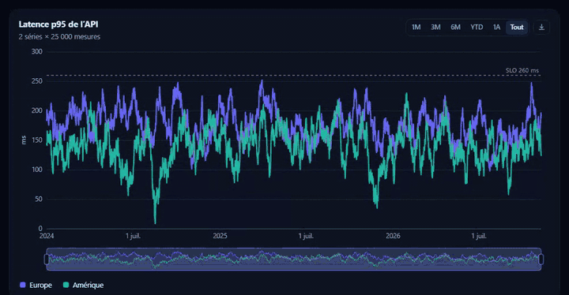
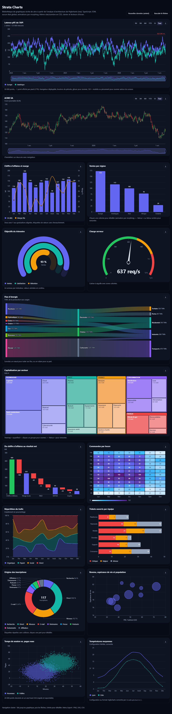
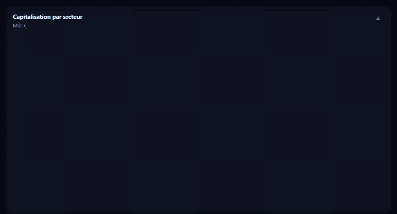
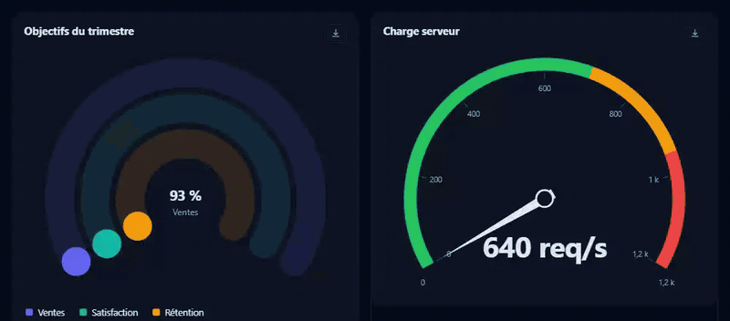
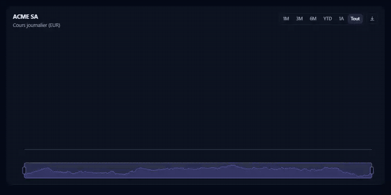

<div align="center">

# Strata Charts

**Beautiful, fast, accessible charts in ~32 kB. Zero dependencies. MIT.**

15 chart types · morphing animations · stock-style navigator · drilldown · dark mode · keyboard & screen readers · Highcharts config converter

[](LICENSE)
[](#size)
[](package.json)
[](tsconfig.json)
[](tests)

### [▶ Live demo](https://robinberaud.github.io/strata-charts/) · [Quick start](#quick-start) · [Chart types](#chart-types) · [Migrate from Highcharts](#migrating-from-highcharts) · [How it was built](#how-it-was-built)



<sub>50,000 points, drawn at ~1 point per pixel (LTTB). Drag the navigator, click a period, ctrl/⌘ + wheel to zoom.</sub>

</div>

---

## Why Strata?

- **Small.** All 15 chart types in **90 kB minified / 32 kB gzip**, versus 280 kB / 102 kB for the Highcharts core alone, before its stock, more, heatmap, drilldown, exporting and accessibility modules.
- **Smooth.** A keyed retained-mode scene morphs every shape from the old state to the new one: new data, legend toggles, zoom and drilldown alike. No redraw flash.
- **No global state.** Each chart gets its own series types. Nothing patches shared prototypes, so you can import only what you use: `sideEffects: false`, tree-shakable.
- **Dense data.** Line series are downsampled with LTTB; scatter plots switch to a single-path renderer above 1,500 points (20,000 points stay fluid and remain vector for export).
- **Dark mode for free.** Theming is plain CSS custom properties. It follows `prefers-color-scheme`, respects `prefers-reduced-motion`, and you restyle it with CSS.
- **Accessible by default.**
  - The chart is focusable, arrow keys walk the data and Enter drills down.
  - An `aria-live` region announces values.
  - Legend entries are real `<button aria-pressed>`.
- **Safe.** Tooltips and labels never inject HTML. Custom formatters return text or a DOM `Node`.
- **Smart labels.** Data labels avoid each other and flip inside bars when needed, with contrast-aware text colour. Pie labels are spread so they never overlap.
- **Real locales.** Numbers and dates go through `Intl` (`locale: 'fr-FR'`, `'ja-JP'`, …), and time axes pick calendar-aware ticks.
- **Exports.** PNG, standalone SVG (styles inlined) and CSV, from a built-in menu or the API.

<div align="center">

</div>

## Chart types

<table>
<tr>
<td width="50%"><br/><b>Drilldown</b>: click a column and the bars morph into its children; Back or Backspace goes up.</td>
<td width="50%"><br/><b>Treemap</b>: squarified layout, two levels at a time, click to zoom into a group.</td>
</tr>
<tr>
<td><br/><b>Sankey</b>: gradient ribbons; hovering a node isolates its flows.</td>
<td><br/><b>Gauge</b>: activity rings (one per KPI) or a classic dial with a needle and zones.</td>
</tr>
<tr>
<td><br/><b>Candlestick / OHLC</b>: navigator, period buttons, OHLC tooltip with % change.</td>
<td><br/><b>Two y axes</b> with aligned ticks, collision-free data labels and morphing updates.</td>
</tr>
</table>

`line` · `spline` · `area` · `areaspline` (stacked, normal or percent) · `column` · `bar` · `scatter` · `bubble` · `candlestick` · `ohlc` · `waterfall` · `heatmap` · `pie` · `donut` · `gauge` · `treemap` · `sankey`

Axes: linear, logarithmic, time and category, with any number of y axes and plot lines.

## Quick start

```bash
npm install github:RobinBeraud/strata-charts
```

```html
<div id="chart"></div>
<script type="module">
  import { createChart } from 'strata-charts';

  const chart = createChart('#chart', {
    type: 'column',
    title: 'Revenue',
    locale: 'en-US',
    dataLabels: true,
    yAxis: [{ title: 'k$' }, { title: 'Margin %' }],
    series: [
      { name: 'Revenue', data: [['Q1', 120], ['Q2', 140], ['Q3', 165], ['Q4', 190]] },
      { name: 'Margin', type: 'spline', yAxis: 1, data: [['Q1', 21], ['Q2', 24], ['Q3', 23], ['Q4', 27]] },
    ],
  });

  chart.on('click', e => console.log(e.points));
  chart.setData(0, [['Q1', 130], ['Q2', 150], ['Q3', 170], ['Q4', 210]]); // animates
</script>
```

<details>
<summary><b>More examples</b>: time series with navigator, sankey, treemap, gauge, drilldown</summary>

```ts
// Time series with a navigator and period buttons
createChart(el, {
  xAxis: { type: 'time' },
  navigator: true,
  zoom: true,
  series: [{ name: 'Latency', data: points /* [timestamp | Date | ISO string, value][] */ }],
});

// Sankey
createChart(el, {
  type: 'sankey',
  series: [{ name: 'Energy', suffix: ' TWh', data: [['Nuclear', 'Electricity', 320], ['Electricity', 'Homes', 160]] }],
});

// Treemap (hierarchy through id / parent)
createChart(el, {
  type: 'treemap',
  series: [{ data: [
    { id: 'tech', name: 'Technology' },
    { name: 'Software', parent: 'tech', value: 420 },
    { name: 'Chips', parent: 'tech', value: 310 },
  ] }],
});

// Gauge: rings, or `needle: true` with zones
createChart(el, {
  series: [{ type: 'gauge', suffix: ' %', data: [{ name: 'Sales', y: 72 }, { name: 'NPS', y: 58 }] }],
});

// Drilldown
createChart(el, {
  type: 'column',
  series: [{ data: [{ x: 'Europe', y: 173, drilldown: 'eu' }, { x: 'Asia', y: 108 }] }],
  drilldown: { series: [{ id: 'eu', name: 'Europe', data: [['France', 37], ['Germany', 42]] }] },
});
```

</details>

### Import only what you use

```ts
import { Chart } from 'strata-charts/core';
import { line, column } from 'strata-charts';

new Chart(el, options, { types: [line, column] }); // other series types are tree-shaken
```

Writing your own series type is a plain object, `{ type, kind, render(ctx) }`. See [`src/series`](src/series) for 15 examples.

## Migrating from Highcharts

```ts
import { createChart } from 'strata-charts';
import { convertHighcharts } from 'strata-charts/compat';

const { options, ignored } = convertHighcharts(existingHighchartsConfig);
console.log('Not converted:', ignored); // e.g. ["annotations", "series[2].xAxis (multiple x axes)"]
createChart('#chart', options);
```

The converter maps the common options:
- Highcharts 13 `dataTable` + `dataMapping`, `pointStart` / `pointInterval`;
- format strings such as `{point.y:.1f} mm` (tooltips, axis and data labels);
- chart types, titles (HTML stripped), axes (multiple y axes, plot lines and bands, hidden axes);
- stacking, tooltip suffix and decimals, legend, data labels, zoom;
- navigator and range selector, drilldown, `colorAxis` stops;
- solid gauges, treemap `id`/`parent`, sankey `from`/`to`/`weight`.

It tells you exactly what it ignored.

**What Strata does not do (yet):**
- maps, Gantt, 3D;
- annotations, technical indicators, sonification;
- multiple x axes, `responsive.rules`.

If you rely on those, Highcharts remains the more complete product.

## How close is it to Highcharts?

Measured against the **165 official examples** shipped with Highcharts 13.1.1. Each example's real config goes through `convertHighcharts()`, is rendered by Strata, and is compared side by side with the original.

| | |
|---|---|
| Examples rendered **faithfully** | **51 / 165** (31 %) |
| Faithful **or close** | **75 / 165** (45 %) |
| Weighted visual score on the chart types Strata supports | **77 %** |
| Config options used by the examples that Strata honours (usage-weighted) | **46 %** |
| Chart types | 17 / 71 (no polar, 3D, maps, Gantt; no stock indicators yet) |

Strata is close on the everyday charts. The gap is breadth: missing chart types and fine-grained styling options. Full method, per-example verdicts and roadmap: [docs/COMPARAISON-HIGHCHARTS.fr.md](docs/COMPARAISON-HIGHCHARTS.fr.md) (French). The harness to reproduce it is in [docs/compare](docs/compare).

<a id="size"></a>

## Size

| | minified | gzip |
|---|---|---|
| **Strata**, all 15 types | 90 kB | **32 kB** |
| Highcharts 13.1.1, core only | 280 kB | 102 kB |
| Highcharts core + stock + more + heatmap + drilldown + exporting + accessibility | ≈ 710 kB | — |

The scopes differ: Highcharts covers many more features. These numbers show what the Strata feature set costs.

## How it was built

Strata started as a **reverse-engineering study of Highcharts' architecture** using [rea](https://github.com/morluto/rea), a static analysis tool.

**What the analysis covered:** 1,009 modules, 515k AST nodes, and a dependency graph of 9,168 relations.

**What it found:**
- Everything runs through a few hub modules: `Utilities` is imported by 416 modules, the global `H` object by 257.
- Features are attached by mutating shared prototypes: 230 `compose()` calls and 342 `.prototype.` assignments.
- Files are huge (`Series.js` is 157 kB) and defaults are deep-merged everywhere.

Strata is a **clean-room rewrite** that keeps the good parts (a declarative options object, no import cycles) and redesigns the rest. No Highcharts code was copied. Only the public option *names* are mirrored by the converter.

**Read the full study:**
- 📄 Report (French): [docs/RETRO-INGENIERIE.fr.md](docs/RETRO-INGENIERIE.fr.md)
- 📊 Raw metrics and script: [docs/rea](docs/rea)

## Development

```bash
npm install
npm run dev        # demo on http://localhost:5199
npm test           # 56 tests (Vitest + jsdom)
npm run build      # dist/ (ESM + .d.ts)
```

Deep link to one chart of the demo: `?solo=c-sankey` (comma-separate several ids), `&theme=dark`.

## Contributing

Issues and PRs are welcome. The most wanted:
- new series types (radar, funnel, box plot…);
- an optional Canvas/WebGL renderer for very large datasets;
- `responsive` rules.

Please run `npm test` before opening a PR.

---

<div align="center">

**If Strata saves you a licence fee or a few hundred kilobytes, a ⭐ helps other people find it.**

<sub>MIT © Robin Béraud-Sudreau · Highcharts is a registered trademark of Highsoft AS; Strata is an independent project and is not affiliated with Highsoft.</sub>

</div>
